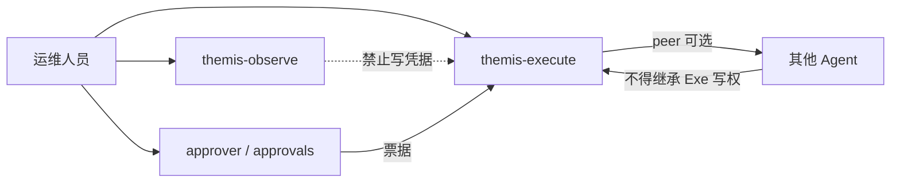

# 多 Agent / Peer 信任边界

> 对应 OWASP Agent Cheat Sheet OA-7。Hermes 多实例或 peer 委托时，默认假设**对方可能被注入或失陷**。

## 硬规则

1. **身份不共享写权限**：`themis-observe` 不得持有 execute 的生产写凭据；peer 调用不得把调用方升级为被调用方的管理员。
2. **工具集不隐式合并**：跨 profile/peer 不得自动并集 `disabled_toolsets` 的补集；委托（delegation）默认关闭（observe 模板已禁）。
3. **权限不沿链条升级**：Agent A 批准的范围不能被 Agent B 扩大；每次跨 Agent 写操作须**新的**审批票据（独立 `argv_digest`）。
4. **熔断**：检测到异常委托、凭据外借或审批绕过 → 降级 observe-only，走 `incident-response`。
5. **审计**：跨 Agent 调用必须记 `trace_id`、调用方、被调用方、tool、票据 ID。

## 信任边界图（逻辑）



## 审查步骤

1. 列出所有生产 profile 与 peer 端点。
2. 核对 secrets / toolset / inventory 是否串用。
3. 核对 delegation / cron / 自动调用链是否关闭或有独立票据。
4. 验证熔断与审计字段。
5. 输出 `pass|blocked`。

## 输出

```yaml
agents_reviewed: [<profile-or-peer>]
credential_isolation: true|false
delegation_default: deny|allow
chain_privilege_escalation_blocked: true|false
status: pass|blocked
```
