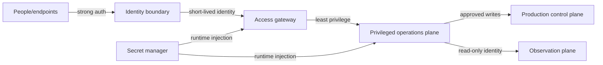

# Operations Threat Modeling

> SECURITY.md remains authoritative. This method translates its six laws into reviewable models without weakening them.

## Asset Classification

| Tier | Asset type | Worst impact | Minimum controls |
|------|------------|--------------|------------------|
| A0 | Identity, secret manager, production cluster control plane | Domain-wide control | MFA, least privilege, dual approval, complete audit |
| A1 | Gateway, configuration, messaging, scheduling, bastion | Cross-system movement | No public exposure, strong auth, read/write separation |
| A2 | Services, databases, artifacts, pipelines | Business or supply-chain impact | Workload identity, granular authorization, rotation |
| A3 | Logs, monitoring, read-only inventory | Topology disclosure | Redaction, read-only credentials, access audit |

Classify by worst reachable impact. An asset that can indirectly obtain A0 authority is managed as A0.

## Trust-Boundary Diagram



For every crossing, record the principal, credential source, authorization scope, network exposure, and audit destination. Treat unproven boundaries as untrusted.

## Abstract Attack Chains

| Chain | Critical transition | Laws | Control points to verify |
|-------|---------------------|------|--------------------------|
| SSO cascade | Identity session → Gateway → multiple backends | 1, 3, 5 | MFA, short sessions, per-service authorization, read/write separation |
| Gateway → configuration → k8s | Edge credential → configuration secrets → cluster control plane | 2, 4, 5 | No reusable secrets, private management plane, least-privileged workloads |
| Phishing boundary breach | User endpoint → identity → operations entry | 1, 6 | Phishing-resistant auth, device binding, non-disableable anomaly audit |
| Default credential to privileged plane | Weak identity → management service → lateral control | 1, 3, 4 | No default credentials, reject empty auth, zero public management exposure |

These chains use roles and planes only; never include real addresses, accounts, passwords, tokens, or field topology.

## Modeling Procedure

1. Inventory assets and flows, then classify by worst-case impact.
2. Mark identity, network, authorization, and human-approval boundaries.
3. Enumerate paths from each external entry to A0/A1 assets.
4. Map every transition to the six SECURITY.md laws and collect evidence or gaps.
5. Prioritize removal of shared identities, plaintext secrets, and public management planes.
6. Assign owner, deadline, and retest method; unverified controls remain open.

## Output Template

```yaml
asset: <abstract asset>
classification: A0|A1|A2|A3
trust_boundary: <boundary>
attack_path: [<abstract step>]
security_laws: [1, 2, 3, 4, 5, 6]
controls: [<control and evidence>]
residual_risk: high|medium|low
owner: <role>
```
