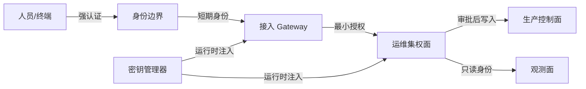

# 运维系统威胁建模

> SECURITY.md 是唯一安全权威；本方法只把六条铁律转化为可审查的威胁模型，不降低其约束。

## 资产分级

| 等级 | 资产类型 | 影响 | 最低控制 |
|------|----------|------|----------|
| A0 | 身份源、密钥管理器、生产集群控制面 | 失陷可导致全域控制 | MFA、最小权限、双人审批、完整审计 |
| A1 | Gateway、配置中心、消息与调度平台、堡垒 | 失陷可跨系统横向移动 | 零公网、强认证、读写隔离 |
| A2 | 业务服务、数据库、制品与流水线 | 失陷影响业务或供应链 | 服务身份、细粒度授权、密钥轮换 |
| A3 | 日志、监控、只读清单 | 可泄露拓扑并辅助攻击 | 脱敏、只读凭据、访问审计 |

定级按“最坏可达影响”而不是当前用途；能间接取得 A0 权限的资产按 A0 管理。

## 信任边界图



每条跨界数据流必须记录主体、凭据来源、授权范围、网络暴露和审计去向。无法证明的边界按不可信处理。

## 抽象攻击链

| 攻击链 | 关键跃迁 | 对应铁律 | 应验证的阻断点 |
|--------|----------|----------|----------------|
| SSO 级联 | 身份会话 → Gateway → 多个后台 | 1、3、5 | MFA、短会话、逐服务授权、只读/写入身份分离 |
| Gateway → 配置中心 → k8s | 接入层凭据 → 配置密钥 → 集群控制面 | 2、4、5 | 无可复用密钥、管理面私网、工作负载最小权限 |
| 钓鱼破边界 | 人员终端 → 身份源 → 运维入口 | 1、6 | 抗钓鱼认证、设备约束、异常登录审计且不可关闭 |
| 默认凭据集权面 | 弱身份 → 管理平台 → 横向控制 | 1、3、4 | 禁默认凭据、拒绝空认证、管理面零公网 |

以上仅描述角色和控制面，不记录真实地址、账号、口令、令牌或现场拓扑。

## 建模步骤

1. 建立资产与数据流清单，按最坏影响分级。
2. 标注身份、网络、权限和人工审批边界。
3. 从每个外部入口反向枚举可达 A0/A1 资产的路径。
4. 将每次跃迁映射到 SECURITY.md 六条铁律，记录现有证据与缺口。
5. 优先消除能“一步跨多域”的共享身份、明文密钥和公网管理面。
6. 输出负责人、整改期限和复验方式；未验证项不得标记已缓解。

## 输出模板

```yaml
asset: <抽象资产名>
classification: A0|A1|A2|A3
trust_boundary: <边界>
attack_path: [<抽象步骤>]
security_laws: [1, 2, 3, 4, 5, 6]
controls: [<控制及证据>]
residual_risk: <高|中|低>
owner: <角色>
```
